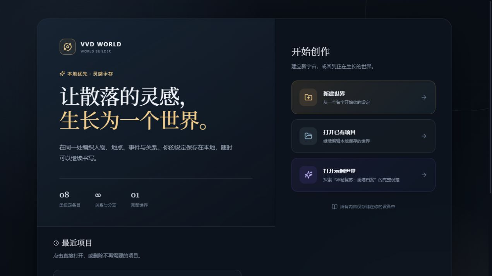
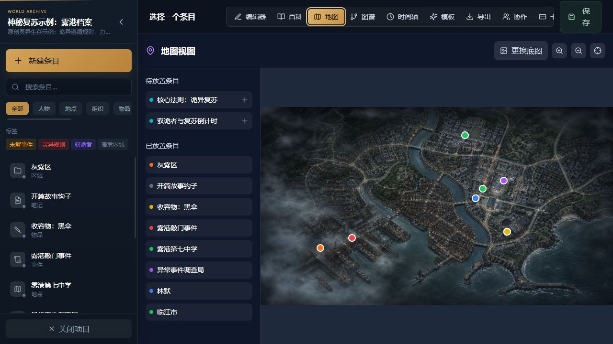
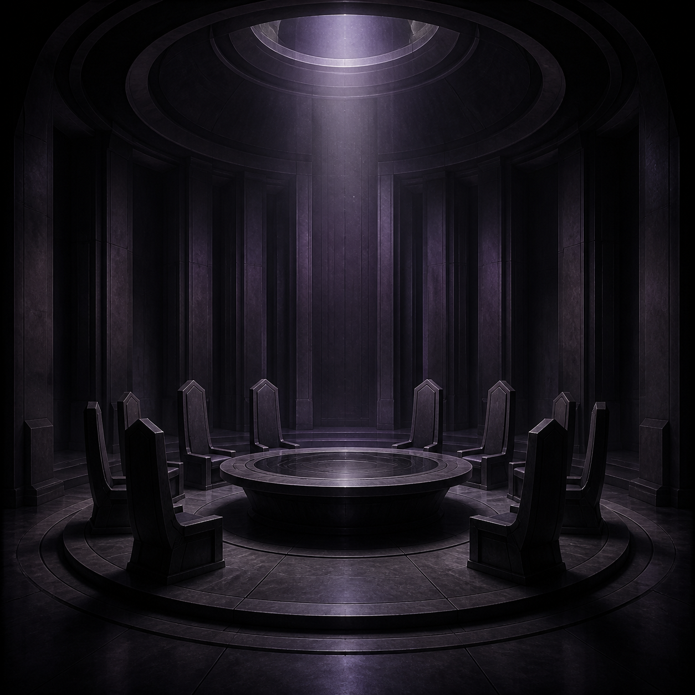

# WD World

English | [简体中文](README.md)

[](https://github.com/actrox/wdWorld/actions/workflows/ci.yml)
[](https://github.com/actrox/wdWorld/actions/workflows/deploy-pages.yml)

A local-first worldbuilding workbench for OC creators, novelists, and TRPG game masters. Characters, locations, factions, events, items, and world rules stay on your device, so writing can continue offline.

## Online Demo

- Planned URL: [WD World Online Demo](https://actrox.github.io/wdWorld/)
- The repository must enable **Settings → Pages → Build and deployment → GitHub Actions** before the first deployment.
- Browser data remains in the current browser and is not uploaded to a server.
- Once Pages is enabled, pushes to `main` are deployed automatically.

## Screenshots

### Welcome page and example world



### Interactive map



## Features

- Project management: create a blank world, open a local backup, resume recent projects, or open the standalone example world.
- Eight entry types: character, location, faction, item, event, lore, region, and note.
- Editor workspace: encyclopedia-style collapsible directory, quick create/delete actions, TipTap rich text, aliases, tags, custom fields, and internal links.
- Card view: cover-based navigation, vertical and horizontal layouts, Markdown and plain-text copy. Portrait and landscape covers are shown without cropping.
- Wiki view: type-based reading directory, tag filters, relation context, and built-in cover artwork.
- Relationship graph: explicit relations, backlinks, and automatic layout.
- Map view: bundled base map, custom base maps, zooming, panning, and interactive entry placement.
- Timeline: world eras, global events, and entry events.
- Import and export: JSON backups, static Wiki export, and automatic local saving.
- Example world: “Mystery Revival Example: Fog Harbor Files,” including rules, characters, locations, relations, a timeline, and original artwork.

## Built-in Original Artwork

The example world includes original covers generated with OpenAI's built-in ImageGen. They do not use characters from existing films, games, or novels.

| Character: Lin Mo                       | Item: Black Umbrella                                    | Location: Fog Harbor No. 7 School                                |
| --------------------------------------- | ------------------------------------------------------- | ---------------------------------------------------------------- |
|  |  |  |

The map artwork is stored at [`src/assets/linjiang-investigation-map.png`](src/assets/linjiang-investigation-map.png), and the example covers are under [`src/assets/sample/`](src/assets/sample/).

## Placeholder Artwork

Entries without a custom cover use bundled artwork based on their type in the editor, Wiki, and card views. A real uploaded cover always takes priority. Covers use contain-style sizing so important content is not cropped.

| Character                                                       | Location                                                      | Faction                                                     | Item                                                  |
| --------------------------------------------------------------- | ------------------------------------------------------------- | ----------------------------------------------------------- | ----------------------------------------------------- |
|  |  |  |  |

## Tech Stack

| Layer            | Technology            |
| ---------------- | --------------------- |
| Desktop shell    | Electron              |
| Frontend         | React 18 + TypeScript |
| Build            | Vite                  |
| Styling          | Tailwind CSS          |
| State management | Zustand               |
| Rich text        | TipTap                |
| Local database   | sql.js / SQLite WASM  |
| Testing          | Vitest + V8 Coverage  |
| Code quality     | ESLint + Prettier     |

## Local Development

Node.js 22.12 or newer is recommended.

```bash
npm install
npm run dev
```

Open `http://localhost:5173` in a browser.

## Quality Checks

```bash
npm run format:check  # Prettier
npm run lint          # ESLint
npm test              # Unit and integration tests
npm run test:coverage # Tests with coverage thresholds
npm run build         # TypeScript and production build
```

The suite currently covers shared utilities, built-in asset mappings, and example-world initialization. Coverage thresholds are configured in [`vitest.config.ts`](vitest.config.ts).

## CI/CD

- [`.github/workflows/ci.yml`](.github/workflows/ci.yml) runs formatting, linting, coverage, and production builds for pushes and pull requests.
- [`.github/workflows/deploy-pages.yml`](.github/workflows/deploy-pages.yml) deploys the `main` branch build to GitHub Pages.

## Desktop Builds

```bash
npm run build
npm run package
npm run electron:build
```

## Local Data

The browser build uses SQLite WASM, IndexedDB, and localStorage. The Electron build stores project data in the application data directory. WD World has no required cloud backend and does not proactively upload worldbuilding data.

Use JSON backups to move projects between devices.
